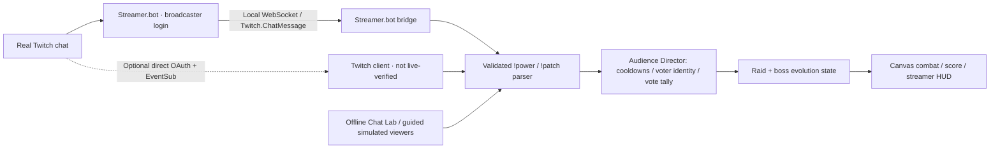

<div align="center">

# PATCH//LIVE
### CODEBREAKERS — THE COMPILER RAID

**Your chat builds the boss. You have to survive it.**

A three-wave, Twitch-interactive arcade raid where viewers can save the streamer, sabotage the fight, and vote on how the final boss evolves.

[**Play the game ↗**](https://patch-live.vercel.app/duel/) · [**Watch the 89-second demo ↗**](https://youtu.be/-sJFZgrkuJM) · [**Devpost submission ↗**](https://devpost.com/software/patch-live-codebreakers)

**JavaScript · Canvas · Twitch chat · Streamer.bot · Codex · Vercel**

<a href="https://youtu.be/-sJFZgrkuJM">
  
</a>

<sub>Demo contains actual offline-guided gameplay and broadcaster-provided Twitch command evidence. It is not uninterrupted live-Twitch footage.</sub>

</div>

---

## The game, in 30 seconds

The streamer fights. **The viewers control the chaos.**

- **Fight, don't just watch.** Move, dash, strike nearby enemies and reflect incoming projectiles into threats.
- **Let chat intervene instantly.** Heal the player, block a hit, upgrade their weapon—or buff the boss and sabotage the arena.
- **Let chat mutate The Compiler.** Major physical-law changes are decided by timed votes, with one counted ballot per real Twitch user ID per round.
- **Progress through a real campaign.** Defeat minions, break the Sentinel, then face a multi-form procedural final boss.
- **Chase a better run.** Score kills, reflections and wave clears; beat a locally saved personal best.

**The game is playable immediately without Twitch credentials.** The offline guided run and Chat Lab are clearly marked *simulated*. Real chat requires a separate Twitch connection, described below.

| Try it | Purpose |
| :--- | :--- |
| [**Codebreakers / Play**](https://patch-live.vercel.app/duel/) | Main three-wave raid, manual play, offline guided demo and Twitch connection |
| [**Cinematic landing**](https://patch-live.vercel.app/) | Original animated Compiler key art and product introduction |
| [**Architect / Legacy mode**](https://patch-live.vercel.app/play/) | Preserved original boss encounter; not the primary submission |
| [**Project on Devpost**](https://devpost.com/software/patch-live-codebreakers) | Submitted hackathon story and project media |
| [**YouTube demo**](https://youtu.be/-sJFZgrkuJM) | 89-second edited walkthrough and evidence excerpts |

## How to play

| Streamer control | Action |
| :--- | :--- |
| **A / D** or **← / →** | Move across the arena |
| **Space** or **J** | Reflect a *nearby* falling projectile; strike a Glitchling at close range |
| **Shift** or **K** | Dash to avoid danger |
| **Touch controls** | Mobile equivalents below the arena |

Start with **START THE RAID** for manual play. Read the contextual **STREAMER GUIDE** when a projectile or nearby enemy needs attention. **HOW TO PLAY** expands a full controls/goal explanation.

For a walkthrough, choose **WATCH THE CHAOS**. That mode uses six **simulated** viewers and the real campaign/combat rules. It can reach a genuine victory by defeating the final boss, but it is **not** a Twitch session.

### Three stages, one evolving monster

| Wave | Encounter | Win condition |
| :---: | :--- | :--- |
| **01 · System Breach** | Glitchlings + Packet Drones | Delete **12** minor enemies |
| **02 · Firewall Uprising** | **The Sentinel** + supporting enemies | Defeat the **300-HP** miniboss using reflected attacks |
| **03 · Final Compilation** | **The Compiler**, affected by accumulated mutations | Reduce the final boss to **0 HP** before time runs out |

The Compiler is **original procedural game art**, not an OpenAI mascot or official Twitch/OpenAI character. Its three audience-driven morphologies are **Stack Overflow**, **Recursive Entity** and **Null Devourer**, with armor, frenzy, physics and attack effects that change the fight—not just the text on screen.

Manual raids use real damage and defeat states, a four-minute clock and wave rewards. The streamer starts with three shields, opening grace protection and increasing projectile damage across waves. Wave transitions restore health and award a shield/weapon upgrade. Scores and personal bests live in the browser; **there is no multiplayer leaderboard or payments backend**.

## Twitch chat: make the audience part of the fight

Viewers type commands **in the broadcaster's Twitch chat**, not in a text field on the game page. During an active raid:

| Chat command | What happens |
| :--- | :--- |
| `!power shield` | Adds protection when the shield cap permits |
| `!power medkit` | Restores up to **24 HP** |
| `!power lance` | Temporarily equips longer-range reflection |
| `!power cannon` | Temporarily equips stronger return shots |
| `!power armor` | Raises the boss's maximum health, within a cap |
| `!power shackle` | Temporarily restricts streamer movement |
| `!power timecut` | Removes a bounded amount of raid time |
| `!power squeeze` | Temporarily narrows the arena |
| `!patch meteor+moon` | Votes for a combined physical-law mutation |

**Instant powers** have global/viewer/effect cooldowns; they do not wait for a poll. **Physics/evolution votes** use a timed round and one counted vote per Twitch user ID; changing a vote replaces the earlier choice. The allowlist comprises **18 powers** and **6 physics rules**. See [`src/audience-director.js`](src/audience-director.js) and [`src/patches.js`](src/patches.js) for the exact supported syntax and limits.

### Connect real Twitch chat — the tested Streamer.bot route

This uses the broadcaster's **authorized Twitch login inside Streamer.bot** and a **local WebSocket bridge**. It avoids registering a new custom Twitch developer application, but **it does not bypass Twitch authorization**.

1. Install the Windows app from [streamer.bot/downloads](https://streamer.bot/downloads).
2. In Streamer.bot, open **Platforms → Twitch → Accounts** and authorize the **Broadcaster Account**.
3. Under **Servers/Clients → WebSocket Server**, start a server bound to **`127.0.0.1`**, port **`8080`**, endpoint **`/`**. Keep it on loopback; do not expose that server to the internet.
4. On **the same computer**, open [the Codebreakers game](https://patch-live.vercel.app/duel/) → **CONNECT TWITCH** → **CONNECT LOCAL STREAMER.BOT**. If the browser prompts for access to the local network, allow it.
5. First confirm **STREAMER.BOT / WAITING FOR CHAT**. That proves a local subscription, **not** a real Twitch event.
6. Start a raid and type `!power shield` or `!power medkit` in the channel's Twitch chat. When an authenticated, non-test `Twitch.ChatMessage` arrives through Streamer.bot, the UI can show **TWITCH / CHAT RECEIVED**, the viewer's username and an eligible in-game effect.

**Evidence level:** the broadcaster tested Streamer.bot and provided screenshots showing their `!power shield` message credited in-game; they confirmed that it worked. We did **not** independently archive raw Twitch transport logs. The uploaded demo uses screenshots for this evidence and offline-guided footage for the complete campaign.

The bridge connects only to `ws://127.0.0.1:8080/`, requests `Twitch.ChatMessage`, rejects explicitly marked test messages and malformed/anonymous chat, and deduplicates message IDs. It does **not** support password-enforced Streamer.bot WebSocket authentication; keep the default listener **local-only**, not internet-accessible.

For setup details: [Streamer.bot WebSocket configuration](https://docs.streamer.bot/api/websocket/guide/configuration) · [Twitch account setup](https://docs.streamer.bot/guide/platforms/twitch/)

<details>
<summary><strong>Alternative: direct Twitch OAuth + EventSub (implemented, not live-verified)</strong></summary>

1. Register a **Public** application in the [Twitch Developer Console](https://dev.twitch.tv/console/apps) and configure the exact redirect URI `https://patch-live.vercel.app/duel/`.
2. In Codebreakers, choose **CONNECT TWITCH** and enter the application's public Client ID.
3. Approve `user:read:chat`. The browser flow validates its OAuth state and access token.
4. The client connects to Twitch EventSub WebSockets and subscribes to `channel.chat.message` after the welcome session; it also implements reconnect and revocation handling.
5. Verify with a real permitted viewer message before describing this method as working live.

This direct route has **not** been end-to-end tested with authenticated Twitch credentials. Never commit access tokens or Client Secrets.

References: [Twitch chat subscriptions](https://dev.twitch.tv/docs/eventsub/eventsub-subscription-types/) · [Twitch EventSub WebSockets](https://dev.twitch.tv/docs/eventsub/handling-websocket-events)

</details>

## Reproduce locally

**Requirements:** Node.js **20+**; no production npm dependencies.

```bash
git clone https://github.com/Iniwura/patch-live.git
cd patch-live
npm install
npm test
npm run build
npm run dev
```

Open **http://localhost:4173/duel/** for Codebreakers or **http://localhost:4173/** for the landing page.

To preview the exact output produced by the build:

```bash
npm run preview
```

`dist/` is generated by `npm run build`. Edit the source HTML/CSS/JS instead of generated output. Production deployment uses [`vercel.json`](vercel.json), with the static build output served by Vercel.

### Architecture, at a glance



All code runs in the browser after the static build; the Streamer.bot route depends on **a local desktop application**, not a hosted PATCH relay.

<details>
<summary><strong>Source map for reviewers</strong></summary>

| Path | Responsibility |
| :--- | :--- |
| [`duel/index.html`](duel/index.html) | Codebreakers UI and controls |
| [`src/duel.js`](src/duel.js) / [`src/duel.css`](src/duel.css) | Active game loop, Canvas combat, scoring, UI, audio and touch |
| [`src/raid-campaign.js`](src/raid-campaign.js) | Three-wave objectives, minions and Sentinel |
| [`src/raid-coach.js`](src/raid-coach.js) | Contextual streamer coaching and combat balance |
| [`src/audience-director.js`](src/audience-director.js) | Exact command allowlist, instant powers, identity and ballots |
| [`src/patches.js`](src/patches.js) / [`src/boss-evolution.js`](src/boss-evolution.js) | Physics recipes and persistent boss mutations |
| [`src/codex-monster.js`](src/codex-monster.js) | Original procedurally drawn Compiler forms |
| [`src/streamerbot-bridge.js`](src/streamerbot-bridge.js) | Local, read-only Twitch chat transport |
| [`src/twitch.js`](src/twitch.js) | Optional OAuth / EventSub WebSocket client |
| [`src/landing.js`](src/landing.js) / [`src/landing.css`](src/landing.css) | Cinematic product landing |
| [`play/`](play/) / [`src/engine.js`](src/engine.js) | Preserved Architect encounter |
| [`tests/`](tests/) | Unit, regression, gameplay and UI checks |
| [`scripts/build.mjs`](scripts/build.mjs) | Static site bundling |

</details>

## Verification & evidence

| Verification | Status |
| :--- | :--- |
| **Node automated tests** | **64 passing** on the last verified main release; rerun `npm test` for the current branch |
| **Production build** | Verified `npm run build` on the final UI release |
| **Browser smoke** | Desktop and phone-size Chromium checks passed for landing/game, controls and Streamer.bot modal |
| **Campaign** | Actual engine completes three waves, defeats The Compiler and records victory/score in guided testing |
| **Streamer.bot connected chat** | Broadcaster screenshot and direct confirmation of a credited Twitch command; not a raw event log |
| **Direct OAuth/EventSub live** | **Not verified** |
| **Monetization / public multiplayer leaderboard** | **Not implemented** |

Verification is specific to the tested revision and environment; no claim of a full security audit or universal browser compatibility is made. See the dated [`LIVE_EVIDENCE.md`](LIVE_EVIDENCE.md) and [`CODEX_FINAL_CLEANUP.md`](CODEX_FINAL_CLEANUP.md) for exact scope and historical test results.

### Built with Codex — with attribution that matches the record

The foundation and original Architect encounter were built in the user's **genuine Codex desktop session**, followed by a Codex engineering cleanup that fixed timing, focused-input handling and Twitch revocation behavior ([PR #7](https://github.com/Iniwura/patch-live/pull/7)). The original **session ID was verified via `/status`** and supplied in Devpost.

**Later Codebreakers expansion, Streamer.bot integration and the final visual redesign were implemented separately**, with ChatGPT-assisted work and GitHub changes. This repository does **not** claim that every line was written in Codex.

- [Codex worklog](CODEX_WORKLOG.md) and [verified cleanup](CODEX_FINAL_CLEANUP.md)
- [Original gameplay/audience implementation PR](https://github.com/Iniwura/patch-live/pull/5)
- [Twitch bridge PR](https://github.com/Iniwura/patch-live/pull/8)
- [Onboarding and gameplay balance PR](https://github.com/Iniwura/patch-live/pull/9)
- [Final UI design PR](https://github.com/Iniwura/patch-live/pull/10)

**Submission:** [Codex × TwitchCon Hackathon entry](https://devpost.com/software/patch-live-codebreakers) · [YouTube project video](https://youtu.be/-sJFZgrkuJM).

## Security, scope & limitations

- **Not an official Twitch or OpenAI product.** The Compiler character and art are original.
- Viewer input is treated as **untrusted data**. Commands are parsed against strict predefined effects; chat is never executed as code.
- The optional Streamer.bot WebSocket is **loopback-only** and supports **no password authentication**; exposing it beyond the local PC is unsafe.
- The direct Twitch client uses browser-session storage for the access token; **never put secrets in Git, logs or publicly shared screenshots**.
- Offline guided mode uses simulated viewers and must never be presented as real Twitch chat.
- The game is free to play. **Channel Points, Bits, paid effects, accounts, hosted persistence and public rankings are not included**.

---

<div align="center">

**THE CROWD BUILDS THE BOSS. YOU BREAK IT.**

[**Play Codebreakers**](https://patch-live.vercel.app/duel/) · [**Watch the demo**](https://youtu.be/-sJFZgrkuJM) · [**Explore the source**](https://github.com/Iniwura/patch-live)

</div>
